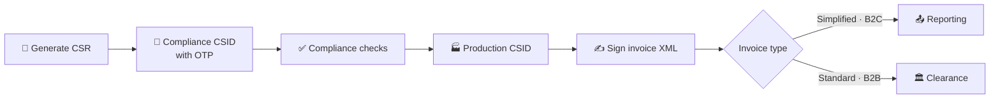

<div align="center">

# 🍽️ Restaurant POS · نقطة البيع

### Touch-first restaurant point of sale for Saudi Arabia — Arabic & English, ZATCA-ready

<p>
  
  
  
  
  
</p>
<p>
  
  
  
</p>

**[✨ Features](#-features) · [🧾 ZATCA](#-zatca-e-invoicing-phase-2) · [🚀 Quick start](#-quick-start) · [🛡️ Roles](#️-roles--permissions) · [🔑 Logins](#-default-logins) · [☁️ Deploy](#️-deployment) · [🗂️ Project map](#️-project-map)**

</div>

---

## 🌟 Why this POS

> A single-page app built from the reference till photos in [`pos/`](pos/). Laravel + **Inertia.js v3 + Vue 3**, with Laravel routes in JS via Ziggy.
> After login, moving between screens, switching language and taking payments **never reload the page**. Only the printable receipt is a separate Blade page, loaded into a hidden frame for printing.

<table>
<tr>
<td width="33%" valign="top">

### 🌙 Arabic-first
RTL by default, instant switch to English, Hijri dates, amounts in Arabic words, and Arabic-Indic digits accepted everywhere.

</td>
<td width="33%" valign="top">

### ⚡ Built for speed
A 5×4 touch grid, quick-cash buttons and auto-printing 80 mm receipts. Every screen opens inside the same frame.

</td>
<td width="33%" valign="top">

### 🧾 Tax-compliant
VAT-inclusive pricing, simplified tax invoices with QR codes, and ZATCA Phase 2 signing, reporting and clearance.

</td>
</tr>
</table>

---

## ✨ Features

| | Feature | What you get |
|:-:|---|---|
| 🌐 | **Two languages** | English (LTR) and Arabic (RTL), switchable from any screen. Products and categories have Arabic and English names. |
| 🛒 | **POS screen** | Category list, product grid, search, cart with qty, item notes, discount (amount or %), customer / table / note, and Takeaway · Dine-in · Delivery. |
| 💳 | **Payment** | Cash (amount received, quick-cash buttons, change) or Card (mada · Visa · MasterCard). |
| 🧾 | **Receipt** | 80 mm *Simplified Tax Invoice* with Arabic and English labels, VAT extracted from VAT-inclusive prices, a daily order number and a **ZATCA QR code**. Prints automatically after payment. |
| 📋 | **Orders** | Daily list, search, view, reprint, and void (admin only). |
| 📊 | **Back office** | Sales report (totals, VAT, by payment / order type / cashier, top products), categories, products, customers and inventory. |
| 🛡️ | **Three roles** | **Super Admin** (everything, incl. Settings), **Admin** (back office) and **Cashier** (the till) — see [Roles](#️-roles--permissions). |
| 🌱 | **Seed data** | The full menu from the photos (8 categories, 155 items) and the store details from the sample receipt. |

<details>
<summary><b>🖥️ POS screen layout (laid out like the reference till)</b></summary>

<br>

- **Header:** order type title, Customer Service (customer details), Open Cash Drawer (prints a "no sale" slip; set the printer driver to open the drawer when it prints), date, time, Hijri date, settings, Notifications (today's orders with a count badge), user menu (language and logout), full screen, reprint last receipt, logout.
- **Body:** categories with ▲▼, a 5×4 item grid with ‹ › pages and Arabic-aware search, and the order panel.
  - The panel has Dine In / Takeaway / Delivery tabs, the order lines, Items Total / Discount Total / Tax Total / Total Before Tax / Tax / Grand Total.
  - A **Qty / Unit Price / Discount (%)** editor for the selected line (per-item discount is stored on the order).
  - Buttons: **Save** (pay and print), **Cancel** (clear), **Print** (kitchen ticket), **Download** (last receipt as a file).
- **Bottom bar**, exactly as in the reference: Reports · Settings · Item List · Customers · Orders · Inventory.
  - These screens open **inside the same frame**: the header and bottom bar stay put and the page doesn't reload.
  - Off the POS, the empty first cell becomes a **POS** button to go back to selling.
  - Categories is a tab inside Item List, and Users is a tab inside Settings.
  - A cashier sees the admin buttons greyed out, and an admin sees Settings greyed out (Super Admin only).
- **Categories:** besides the printed menu, **Ramadan Items (رمضانيات)** and **Add-ons (إضافات)**. Their prices are placeholders, so edit them in Item List. Use Inventory to hide Ramadan Items outside Ramadan.
- **Customers** (admin): built automatically from the phone numbers entered on orders.
- **Inventory** (admin): tap an item to mark it sold out (hidden from the POS) or available again.

📁 `resources/js/pages/Pos/Index.vue` · `resources/css/pos-screen.css`

</details>

<details>
<summary><b>🕌 Arabic-first details</b></summary>

<br>

| | |
|---|---|
| 🔤 **RTL by default** | Arabic is the default language, with an instant switch to English. |
| 🖋️ **Cairo font** | Bundled locally, so it works offline. |
| 🎨 **Green & gold theme** | An Islamic 8-point star (*khatam*) pattern on the header, login and error screens, and faintly behind the content. |
| 📅 **Hijri date (Umm al-Qura)** | Next to the Gregorian date in the POS header, on the receipt and on order details. |
| 💬 **Tafqeet (تفقيط)** | The amount in Arabic words on the receipt and order details, e.g. «فقط اثنان وعشرون ريالاً لا غير». |
| 🔢 **Arabic-Indic digits** | ٢٠ or ١٥٫٥ in amounts and prices, ٠٥٥… in phone numbers. Converted by the `ConvertArabicDigits` middleware and `parseNum()` in JS. |
| 🔍 **Arabic-aware search** | أ/إ/آ = ا, ة = ه, ى = ي, and diacritics are ignored, in the POS search and the admin product search (`products.search_text`). |
| 🚧 **Translated error pages** | 403 / 404 / 429 / 500 / 503, and a friendly message when a session expires (419). |

📁 `app/Support/Arabic.php` · `app/Support/Tafqeet.php` · `resources/js/lib/format.js` · `resources/css/pattern-*.svg`

</details>

---

## 🧾 ZATCA e-invoicing (Phase 2)

Tax invoices, credit notes and debit notes are **signed locally**, then **reported** (simplified · B2C) or **cleared** (standard · B2B) with ZATCA's Fatoora platform. Everything is managed from **Admin → ZATCA** and **Admin → Invoices**.



| Environment | `ZATCA_ENV` | Use it for |
|---|---|---|
| 🧪 Sandbox | `sandbox` | Developer portal: no Fatoora account needed, OTP `123345`. |
| 🎭 Simulation | `simulation` | The Fatoora simulation portal, with a real OTP from fatoora.zatca.gov.sa. |
| 🟢 Production | `production` | Live invoices. |

### 🧾 Every sale is e-invoiced by itself

Once onboarding is done, each POS sale gets its **simplified tax invoice** the moment it is paid:

1. **Signed before the receipt prints** — the receipt carries the **Phase 2 QR** (tags 1–9: hash, signature, public key), and the e-invoice shares the receipt's number (`INV-…`).
2. **Reported to ZATCA after the response** — the till never waits on the network. If ZATCA is down, the sale still goes through and the invoice waits in **Settings → E-Invoices → Submit pending**.
3. **Exact to the halala** — till prices include VAT, so the order's net is spread over the lines in halalas. When net + 15% VAT can't hit the paid total exactly (≈13% of totals, e.g. 10.00 → 8.70 + 1.31), the ±0.01 goes into `PayableRoundingAmount`: the payable amount and QR tag 4 always equal what the customer paid.

Sales made before onboarding keep the Phase 1 QR; issue their e-invoice by hand from the order page. 📁 `app/Services/Zatca/OrderInvoicer.php`

### 🔒 Sandbox VAT numbers (filled in automatically)

While the active environment is **sandbox**, ZATCA's test numbers are filled in and locked — whatever is typed, these are used:

| | VAT number | Where |
|---|---|---|
| 🏪 Shop (seller) | `399999999900003` | ZATCA page, every e-invoice, the printed receipt and its QR code |
| 👤 Customer (buyer) | `311111111111113` | Every e-invoice and credit / debit note, and the B2B compliance checks |

In **simulation** and **production** both fields unlock: the shop's own VAT comes from Admin → Settings, and the customer's is typed on each invoice. Switching away from the sandbox puts the store VAT back automatically. Override the test numbers with `ZATCA_SANDBOX_SELLER_VAT` / `ZATCA_SANDBOX_BUYER_VAT` in `.env`.

> [!IMPORTANT]
> After the seller VAT changes, open **Settings → ZATCA**, press **Save**, then generate a new CSR and onboard again — the old certificate carries the old VAT.

📁 `app/Services/Zatca/` · `config/zatca.php` · `app/Http/Controllers/Admin/ZatcaController.php` · `app/Http/Controllers/Admin/InvoiceController.php`

---

## 🚀 Quick start

> **Requirements:** PHP **8.3+**, Composer 2, Node **20.19+ / 22.12+**

```bash
composer install
npm install
npm run build            # builds the Vue SPA into public/build (re-run after changing resources/js or resources/css)
cp .env.example .env && php artisan key:generate   # skip if .env exists
php artisan migrate --seed
php artisan serve        # → http://127.0.0.1:8000
```

🔥 For hot reload, run `npm run dev` alongside `php artisan serve`.
🪟 On WAMP you can also open `http://localhost/pos_ksa/public`.

<details>
<summary><b>🐬 Using MySQL instead of SQLite</b></summary>

<br>

Edit `.env`:

```env
DB_CONNECTION=mysql
DB_HOST=127.0.0.1
DB_PORT=3306
DB_DATABASE=pos_ksa
DB_USERNAME=root
DB_PASSWORD=
```

Create the `pos_ksa` database (utf8mb4), then run `php artisan migrate:fresh --seed`.

</details>

---

## 🛡️ Roles & permissions

| Screen | 👑 Super Admin | 🧑‍💼 Admin | 🧑‍🍳 Cashier |
|---|:-:|:-:|:-:|
| POS, own orders, receipts | ✅ | ✅ | ✅ |
| All orders, void an order | ✅ | ✅ | — |
| Reports · Item List · Categories · Customers · Inventory | ✅ | ✅ | — |
| **Settings:** Store · Users · ZATCA · E-Invoices | ✅ | — | — |

Locked screens are greyed out in the bottom bar and return **403** if opened by URL. Only a Super Admin manages users, and can't demote or deactivate themselves.

---

## 🔑 Default logins

Created by `DemoUsersSeeder` (part of `php artisan migrate --seed`):

| Role | Email | Password | Login button |
|---|---|---|:-:|
| 👑 Super Admin | `superadmin@pos.test` | `password` | — (type it in) |
| 🧑‍💼 Admin | `admin@pos.test` | `password` | ✅ |
| 🧑‍🍳 Cashier | `cashier@pos.test` | `password` | ✅ |

> [!WARNING]
> **Change these passwords** in Settings → Users before going live — the Super Admin's first.

With `DEMO_LOGINS=true` in `.env`, the Admin and Cashier accounts appear as one-click buttons under the login form. The Super Admin is **never** shown there — not even its email reaches the browser. Set **`DEMO_LOGINS=false`** on a real till: when it's off, no credentials are sent to the browser. Deactivated accounts are never shown.

---

## ☁️ Deployment

Every push to `main` runs [`.github/workflows/deploy.yml`](.github/workflows/deploy.yml):

```
🏗️ Build Vue assets  →  📂 SFTP sync (only changed files)  →  🔀 public/.htaccess  →  ⚡ composer install + Laravel caches
```

Set these in **GitHub → Settings → Secrets and variables → Actions**:

| Secret | Value |
|---|---|
| `SFTP_SERVER` | Host name of the server |
| `SFTP_USERNAME` | The cPanel login |
| `SFTP_PASSWORD` | Its password |
| `SFTP_PATH` | Full path of the Laravel folder (not `public/`), e.g. `/home/<user>/<domain>` |
| `RUN_POST_DEPLOY` | `true` once the server has `vendor/` and `.env` |

> [!NOTE]
> `.env`, `vendor/` and `storage/` contents live only on the server and are never overwritten. Run `php artisan migrate --force` on the server by hand after a deploy that adds a migration.

### 🧰 First-time server setup

```bash
php artisan migrate --force                              # tables; promotes the oldest admin to Super Admin on an old install
php artisan db:seed --class=DemoUsersSeeder --force      # Super Admin / Admin / Cashier accounts
php artisan db:seed --class=MenuSeeder --force           # the menu from pos/ (10 categories, 175 items)
```

Each seeder can run on its own and again safely: they update rows in place and never touch the store settings. (`php artisan db:seed --force` would also overwrite the store details with the sample receipt's.)

For one-click demo logins, add `DEMO_LOGINS=true` to the server's `.env` — once, with no other `DEMO_LOGINS` line above it — then run `php artisan config:cache`.

---

## 🗂️ Project map

| Area | Where |
|---|---|
| 🧩 Pages (one per screen) | `resources/js/pages/**` |
| 🧱 Back-office layout | `resources/js/layouts/AppLayout.vue` |
| 🧷 Components | `resources/js/components/` |
| 🎨 Styles | `resources/css/app.css` |
| 🔗 Shared Inertia props | `app/Http/Middleware/HandleInertiaRequests.php` |
| 🧮 Totals & numbering | `app/Support/OrderService.php` |
| 🔳 Receipt QR | `app/Support/ZatcaQr.php` |
| 🛡️ Roles | `app/Models/User.php` (`ROLES`, `isAdmin()`, `isSuperAdmin()`), `app/Http/Middleware/EnsureSuperAdmin.php`, `routes/web.php` |
| 🔒 Sandbox VAT numbers | `config/zatca.php` (`seller_vat`, `buyer_vat`), `ZatcaSetting::fixedVat()` |
| 🖨️ Printable receipt | `resources/views/orders/receipt.blade.php` |
| 🌍 Translations | `lang/ar.json` (shared with Vue as the `translations` prop, used via `__()` / `useI18n()`) and `lang/ar/validation.php` |

---

## 📝 Notes

- 💰 Prices are entered **including VAT**. The VAT rate (default 15%) is set in Admin → Settings.
- 🌐 Default language is Arabic (`APP_LOCALE=ar`). Timezone is `Asia/Riyadh` (`APP_TIMEZONE`).
- 🧪 Tests: `php artisan test`

<div align="center">

---

<sub>Made with ❤️ for restaurants in the Kingdom of Saudi Arabia 🇸🇦</sub>

</div>
